# Analisa Playtest Berbasis Data — Desa Mandiri

*Dibuat oleh Grok Bot (simulasi headless), 17 Okt 2026. Tidak ada kode game yang diubah.*

## 1. Metode

- **Versi yang dianalisis:** commit `d6ec12fa9618e45dd09ad475ee6c4e97fd4278b2` (`git rev-parse HEAD`, working tree bersih saat disalin). Berkas `balance.js`, `tech.js`, `game.js`, `assets.js`, `audio.js`, `index.html`, `TEKS-GAME.json` disalin ke `/workspace/desa-analisa/snap/` (di luar repo) supaya simulasi memakai versi yang beku.
- **Fidelitas:** yang dijalankan adalah **kode game asli** (`game.js` utuh) di dalam jsdom (Node 20). Kanvas/aset/audio di-*stub*; `DESA.step(0.1)` dipanggil berulang (sama dengan langkah 0,1 dtk di loop `frame()`). AI penduduk, pathfinding A*, musim, ladang, air, spawn, era, event, riset, bengkel/pasar harian semuanya kode asli. `Math.random` diganti RNG ber-seed (mulberry32); peta tetap memakai seed bawaan game (`rng(12345)`), jadi **semua run memakai peta yang sama** — variasi berasal dari event, umur, panen, harga, dll.
- **Run:** 6 pengaturan × 30 seed (1–30) = **180 run**, masing-masing **120 hari** game (= 17 musim, ~4,3 tahun game). Total ±0,5–6 dtk per run.
- **Pengaturan prioritas** (skala 0–3 seperti `DEFAULT_PRIO`):

| Nama | bangun | makanan | bertani | air | kayu | batu | riset |
|---|---|---|---|---|---|---|---|
| Default (`DEFAULT_PRIO`) | 3 | 3 | 2 | 2 | 2 | 2 | 1 |
| Fokus makanan | 3 | 3 | 3 | 2 | 1 | 1 | 1 |
| Fokus kayu | 3 | 2 | 2 | 2 | 3 | 1 | 1 |
| Fokus batu | 3 | 2 | 2 | 2 | 1 | 3 | 1 |
| Seimbang | 2 | 2 | 2 | 2 | 2 | 2 | 2 |
| Idle (tanpa input) | default, tanpa membangun/riset | | | | | | |

- **Pemain-bot** (semua kecuali Idle): sekali per hari, jika tidak ada bangunan yang sedang dikerjakan dan mampu bayar, menaruh bangunan berikut menurut urutan: Api Unggun → Gudang → Gubuk (jika kapasitas ≤ populasi) → bangunan syarat era berikutnya → Sumur → Ladang (sampai ⌈pop/2⌉) → Gubuk cadangan → Dapur/Bengkel → Balai. Riset: memulai tech pertama yang tersedia, hanya jika setelah bayar biaya riset bangunan berikutnya tetap terjangkau. Event: selalu memilih **opsi pertama yang tidak dinonaktifkan** (seperti `tests/balance-sim.test.js`). Pasar (barter manual) **tidak dipakai**.
- **Idle:** tidak membangun/riset; hanya mengklik opsi event pertama (tanpa itu game berhenti pada modal event).
- **Definisi metrik**
  - *Menganggur* = sampel (tiap 1 dtk game) ketika tugas penduduk kosong atau `diam`; penduduk yang tidur dikeluarkan dari penyebut.
  - *Hari datar* = hari tanpa: event, bangunan baru ditaruh atau selesai, riset selesai, kematian, dan tanpa peringatan sumber daya (air habis atau makanan+gandum < 4×populasi). *Rentang membosankan* = ≥3 hari datar berturut-turut.
  - *Terblokir* = bot ingin membangun sesuatu tapi belum mampu bayar (menunggu sumber daya). *Tak ada yang dibangun* = daftar keinginan bot kosong.
  - *Hari stok pangan* = (makanan+gandum)/(pop×2×1,5 saat Dingin), sama dengan `foodPerDay()`.
- Skrip: `/workspace/desa-analisa/sim.js` (harness) dan `analyze.py` (agregasi + grafik); ringkasan mentah `summary.json`.

## 2. Temuan utama

### 2.1 Tidak ada ancaman nyata: 0 kematian dalam 180 run
- **0 kematian dan 0 desa punah** di semua pengaturan (5.400 hari-desa simulasi untuk setiap pengaturan), termasuk Idle.
- Stok pangan minimum (hari ≥8) memang bisa menyentuh 0 (median minimum: Default 4,2 hari; Seimbang 0,25 hari; Fokus kayu 1,4 hari), tetapi tidak pernah menimbulkan kematian: penurunan `HEALTH.starvePerDay` 20/hari baru jalan saat lapar = 0 dan darurat pangan di `chooseTask` (stok < pop×3) segera mengalihkan semua orang ke meramu.
- Setelah hari 60, median stok pangan = **37,7 hari** (Default), **44,8 hari** (Fokus makanan), ~16,6–16,9 hari (Fokus kayu / Seimbang) — jauh di atas `WINTER_BUFFER_DAYS: 8`. Musim Dingin praktis tidak terasa setelah tahun pertama.

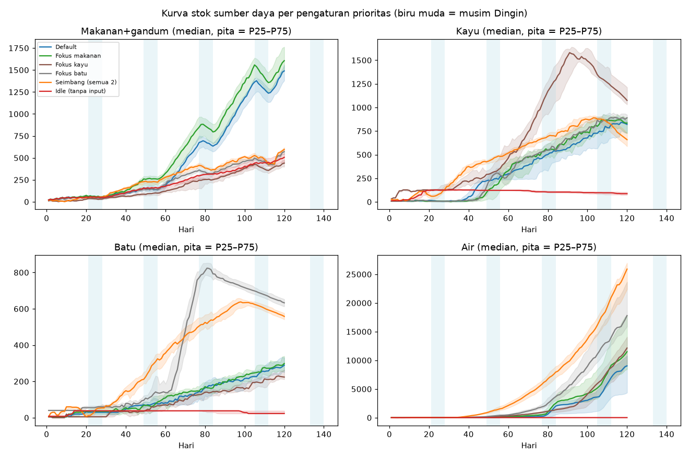

### 2.2 Ledakan stok di paruh kedua (hari 60–120)
Median stok di hari 120 (Default): makanan 1.222, gandum 264, kayu 821, batu 290, **air 9.038 (±606 hari kebutuhan per penduduk)**, alat 33. Seimbang: air 25.905 (1.407 hari/penduduk). Air adalah anomali terbesar: penalti `FOOD_SURPLUS_PENALTY` (25) saat air ≥ `WATER_SURPLUS_DAYS` (8) hari hanya membuat skor air 2×10−25 = −5, tetapi tugas air tetap dipilih bila tugas lain juga terkena penalti/tak tersedia, dan sumur menghasilkan 4 air per 5 dtk kerja. Kayu juga berkumpul hingga ~0,96× batas lunak `RES_SOFT_CAP.kayu` per 2 penduduk (Default) dan 1,48× pada Fokus kayu.

### 2.3 Populasi & waktu era

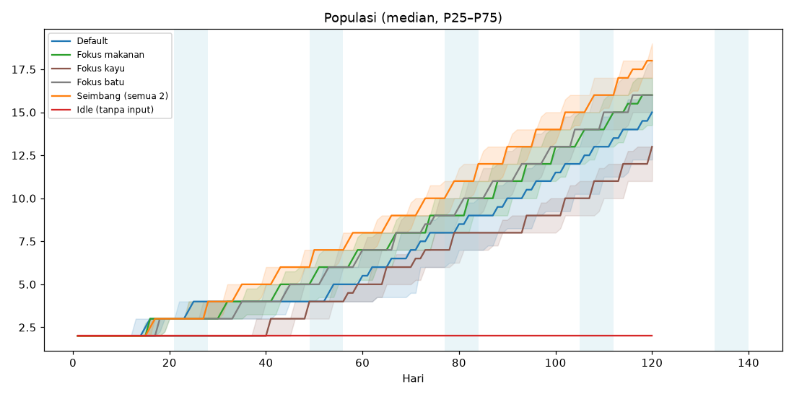
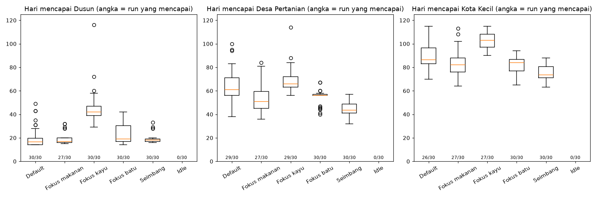

| Pengaturan | Dusun (median hari, P25–P75, tercapai) | Desa Pertanian | Kota Kecil | Pop hari 60 | Pop hari 120 |
|---|---|---|---|---|---|
| Default | 16,5 (14–19,75) 30/30 | 61 (56–71) 29/30 | 86,5 (83–96,5) 26/30 | 5,5 | 15 |
| Fokus makanan | 17 (16–20) **27/30** | 51 (45–59,5) 27/30 | 82 (76–88) 27/30 | 7 | 16 |
| Fokus kayu | **42** (39–47) 30/30 | 66 (63–72) 29/30 | 103 (97–108) 27/30 | 5 | 13 |
| Fokus batu | 19 (17–30,25) 30/30 | 56 (56–57) 30/30 | 84 (77–86,75) 30/30 | 7 | 16 |
| Seimbang | 18 (17–19) 30/30 | **43,5** (41–48,75) 30/30 | **73,5** (71,25–80,5) 30/30 | 8 | 18 |
| Idle | tidak pernah | tidak pernah | tidak pernah | 2 | 2 |

- **Softlock Fokus makanan:** 3/30 run (seed 4, 5, 11) macet di Perkemahan selama 120 hari dengan 2 penduduk dan hanya Api Unggun/Gudang — kayu (prioritas 1) tidak pernah cukup untuk Gubuk (20 kayu). Pemain nyata mungkin akan menyadari, tetapi game tidak memberi sinyal.
- **Fokus kayu menunda Dusun ke hari 42:** median stok batu hari 15–40 hanya 5 (Gubuk butuh 5 batu, Sumur 15) karena batu prioritas 1.
- **Seimbang (semua 2) adalah strategi tercepat** di semua era dan tidak pernah terblokir (0,1% hari) — artinya `DEFAULT_PRIO` justru lebih lambat ±17 hari ke Desa Pertanian daripada "tidak ada prioritas".
- **Idle tidak pernah tumbuh** (pop 2 seumur run: tanpa Gubuk, `capacity()` = 0) tetapi juga tidak pernah mati; makanan menumpuk ke 501.

### 2.4 Event
Rata-rata **20,1–22,9 event per run** (≈1 per 5,5 hari; konsisten dengan `EVENT_CHANCE_PER_DAY: 0.18` mulai hari 3). Terbanyak (Default, total 30 run): wabah 64, badai 63, festival_desa 56, hewan_buas 55, hujan_meteor 53, anak_hilang 49. `panen_raya` hanya 9 (0,3/run), event era lanjut 4–18 masing-masing. Karena bot memilih opsi pertama dan tak ada yang mematikan, event tidak pernah mengubah lintasan secara berarti.

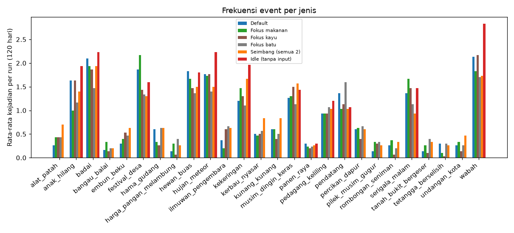

### 2.5 Waktu menganggur penduduk rendah
Rata-rata hanya **2,3–2,8%** waktu bangun dihabiskan menganggur di semua pengaturan — AI selalu menemukan pekerjaan (sering pekerjaan yang tidak berguna, lihat air). Jadi masalahnya bukan penduduk diam, tetapi **pemain** yang tidak punya keputusan.

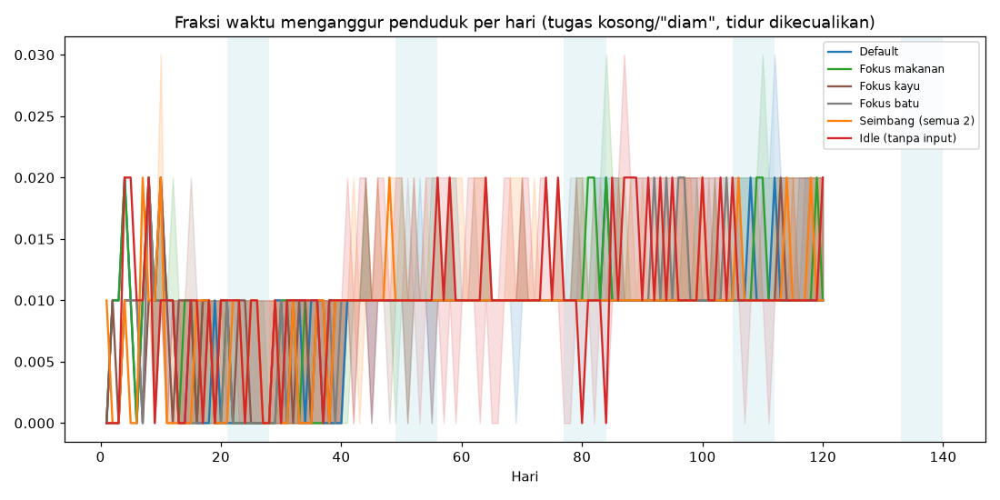

### 2.6 Rentang membosankan
| Pengaturan | % hari datar | Rentang ≥3 hari / run | Rentang terpanjang (median / maks) | % hari "tak ada yang dibangun" | % hari terblokir |
|---|---|---|---|---|---|
| Default | 47,9 | 8,1 | 9 / 20 | 56,4 | 24,2 |
| Fokus makanan | 49,6 | 8,3 | 9 / 22 | 49,1 | 31,5 |
| Fokus kayu | 52,9 | 9,1 | 10 / 23 | 76,2 | 5,9 |
| Fokus batu | 51,5 | 9,2 | 9 / 13 | 54,6 | 23,9 |
| Seimbang | 51,2 | 9,6 | 9 / 13 | 77,3 | 0,1 |
| Idle | 79,8 | 12,1 | 16 / 32 | 100 | 0 |

Hampir separuh hari tidak berisi keputusan. Garis waktu menunjukkan dua pola: (a) hari 1–40 rentang datar karena menunggu kayu/batu (terblokir), (b) setelah Kota Kecil (~hari 75–90) daftar bangunan habis (hanya Balai) dan stok terus naik — setelah itu hanya event yang memutus kebosanan.

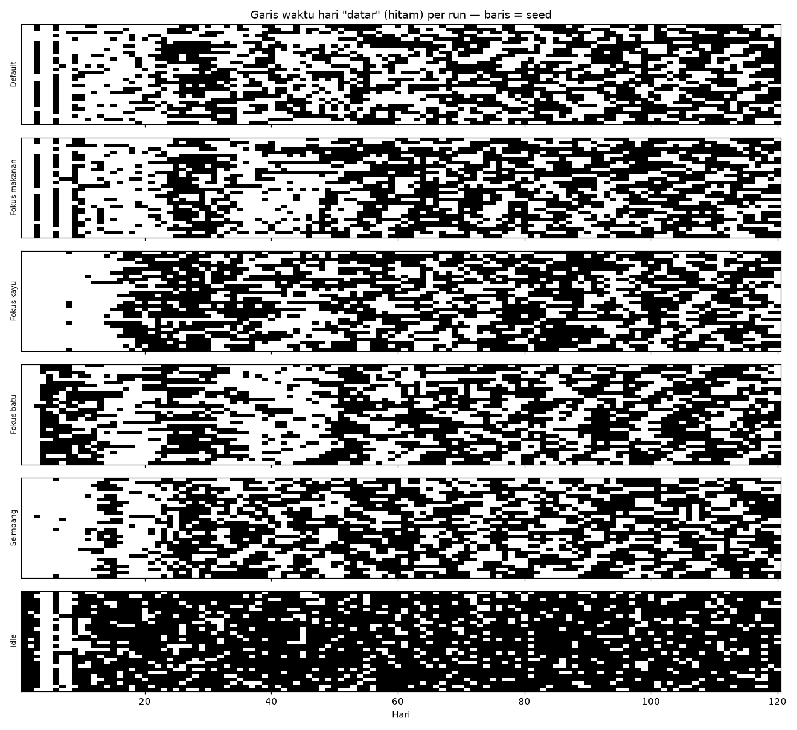
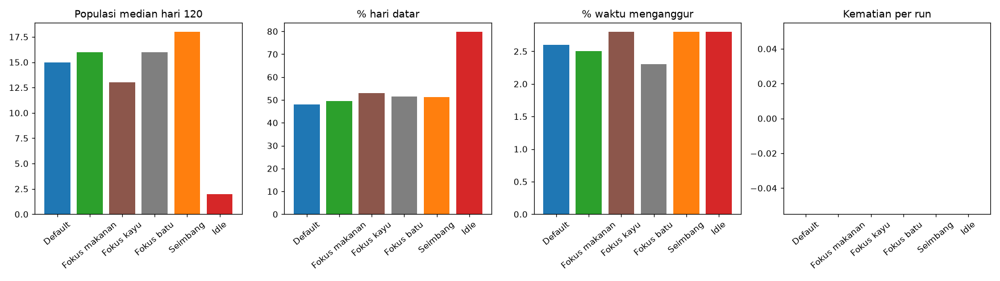

Semua run menyelesaikan seluruh 8 tech yang ada (median 8) sebelum hari 120 — konten riset juga habis.

## 3. Rekomendasi numerik (urut dampak)

1. **Hadirkan risiko nyata di Dingin.** Ubah `WINTER_HUNGER_MULT` dari **1.5 ke 2.0** dan `GRANARY_WINTER_HUNGER_MULT` dari **1.25 ke 1.6**; tambahkan pembusukan stok (mis. makanan −2%/hari di atas 20 hari stok, sesuai arah `RISET-MUSIM-ANCAMAN.md` §2.5). Alasan: 0 kematian di 180 run, stok pasca-hari 60 median 37,7 hari vs target 8.
2. **Hentikan ledakan air.** Naikkan `FOOD_SURPLUS_PENALTY` dari **25 ke 40** (sehingga skor prioritas 3 = 30−40 < 0) *atau* jadikan air ≥ `WATER_SURPLUS_DAYS` sebagai larangan keras; pertimbangkan `WATER.wellYield` **4 → 3**. Alasan: median air hari 120 = 9.038 (Default) s.d. 25.905 (Seimbang).
3. **Perbaiki `DEFAULT_PRIO`.** Ubah ke `{ bangun: 3, makanan: 2, bertani: 2, air: 2, kayu: 2, batu: 2, riset: 1 }` (makanan 3 → 2). Alasan: Seimbang mencapai Desa Pertanian hari 43,5 vs 61 Default, Kota Kecil 73,5 vs 86,5, populasi hari 120 18 vs 15, tanpa kematian. (Perlu run ulang untuk konfirmasi nilai persis ini — belum disimulasikan.)
4. **Cegah softlock kayu.** Turunkan biaya `gubuk.cost.kayu` dari **20 ke 15**, atau tambahkan lantai di AI: bila tidak ada Gubuk dan kayu < biaya Gubuk, kayu diperlakukan sebagai darurat seperti makanan. Alasan: 3/30 run Fokus makanan macet 120 hari di Perkemahan; Fokus kayu menunda Dusun ke hari 42 karena batu 5.
5. **Konten akhir/tujuan setelah Kota Kecil.** Daftar bangunan habis ~hari 75–90 dan 100% run menyelesaikan 8 tech; "tak ada yang dibangun" 56–77% hari. Prioritaskan T09–T20 (sudah direncanakan di `tech.js`) dan bangunan baru dari `RISET-MUSIM-ANCAMAN.md` §3. Tambahan konsumsi pasif: aktifkan konsumsi kayu bakar musim Dingin (`api_kayu_bakar` sudah ada kuncinya) untuk menyerap stok kayu ~820.
6. **Kurangi rentang datar dengan event.** Naikkan `EVENT_CHANCE_PER_DAY` dari **0.18 ke 0.25** setelah era Dusun, dan naikkan bobot `panen_raya` dari 0.35 hanya bila ada ancaman penyeimbang. Alasan: median rentang datar terpanjang 9 hari (maks 20–23) bahkan dengan ~22 event/run.
7. **Era ke-3 terlalu cepat bila stok menumpuk.** Biarkan `ERAS[3].req.foodDays` (12), tetapi naikkan `ERAS[3].req.res.alat` dari **5 ke 10**: median alat di hari 120 = 33–60, sehingga syarat alat tidak berarti.

## 4. Keterbatasan & perbedaan sim vs game nyata
- Satu peta saja (seed peta di-hardcode `rng(12345)` di `newGame`).
- Bot tidak memakai Pasar/pedagang secara manual, tidak memilih opsi event secara cerdas (selalu opsi pertama yang aktif), tidak menempatkan bangunan secara estetis/optimal, dan tidak mengubah prioritas di tengah permainan. Pemain nyata yang aktif kemungkinan lebih cepat; pemain pasif lebih lambat.
- Quest, tutorial, pencapaian, render, dan `menuOpen` tidak memengaruhi simulasi (step dipanggil langsung). Kecepatan 1×; langkah 0,1 dtk sama dengan game.
- Penyebab kematian sudah diinstrumentasi (kelaparan/air/kesehatan/pergi), tetapi tidak ada kematian untuk diklasifikasikan. Penduduk yang "meninggalkan desa" via event juga tidak terdeteksi (opsi pertama tidak pernah berefek `penduduk` negatif).
- Mekanik dari `RISET-MUSIM-ANCAMAN.md` (serigala malam nyata, kebakaran, banjir) yang belum ada di kode tentu tidak tersimulasi; hanya event teks yang ada.
- Rekomendasi #3 dan nilai baru lain **belum** divalidasi dengan run ulang; disarankan menjalankan ulang `sim.js` setelah perubahan.
- **Penting — kode sedang berubah:** setelah snapshot diambil, `balance.js` di working tree (belum di-commit) sudah mendapat tambahan `SEASON_FX`, `YEAR_SCALE`, `FAMINE`, `THREAT` (serigala), dan bangunan pagar/obor/menara jaga/makam. Analisa ini **tidak** mencakup perubahan itu. Rekomendasi #1 (ancaman Dingin) dan #6 (event) mungkin sebagian sudah dijawab oleh pekerjaan tersebut; jalankan ulang `sim.js` (salin ulang snapshot) setelah fitur ancaman masuk ke `game.js` untuk mengukur dampaknya.

---

# v2 (5702b18) — Putaran 2

*Dijalankan ulang 17 Okt 2026 oleh Grok Bot. Konten putaran 1 di atas tetap dipertahankan (commit d6ec12f).*

## v2.1 Metode putaran 2

- **Versi:** commit `5702b18` ("Tahap 4: musim & ancaman (P0-P2) + barang terlihat"). Working tree repo sudah di `c0e08bf` (lebih baru), jadi **tidak di-checkout**; berkas `balance.js, assets.js, audio.js, tech.js, game.js, index.html, TEKS-GAME.json` diambil via `git show 5702b18:<path>` ke `/workspace/desa-analisa/snap-5702b18/`. Repo tidak diubah selain dokumen ini dan grafik `docs/analisa/*-r2.png`.
- **Harness baru** `sim2.js`: tetap menjalankan `game.js` asli di jsdom, `step(0.1)`, RNG ber-seed. Tambahan instrumentasi: kematian per penyebab (diklasifikasi dari status penduduk sesaat sebelum mati: sakit parah / serangan / kelaparan / air), kepergian per penyebab (mood vs lapar), gigitan & damage serigala, malam serangan, kebakaran, banjir, sakit baru & sakit parah, kesehatan minimum, jenjang kelaparan (`famineLevel()`), hari stok pangan (`foodDays()`), aliran pangan harian (produksi = `S.gathered` makanan+gandum; dimakan = estimasi dari kenaikan lapar ÷ `EAT_RESTORE_PER_FOOD`×bonus dapur; busuk = `S.spoiled`), hari gubuk pertama selesai.
- **Bot**: urutan sama dengan putaran 1, ditambah pertahanan: 1 Obor setelah 2 Gubuk; di era Dusun 4 Pagar + total 3 Obor; di Desa Pertanian 1 Menara Jaga (Makam dibangun otomatis oleh game). Event: opsi pertama yang aktif. Modal "Desa Kelaparan" diklik (tombolnya menaikkan prioritas Makanan ke 3, sesuai perilaku game).
- **Run utama:** 6 pengaturan × 30 seed (1–30) × 120 hari = **180 run**. **Eksperimen tambahan** (what-if, kode game di salinan scratch, bukan repo): B = perbaikan bug repair (180 run), C = B + `FOOD_SURPLUS_FACTOR` 1.25 (180 run), D = B + paket usulan (180 run), dan sweep gubuk pertama 45 hari × 100 seed (dasar B dan `START_RES.kayu` 20: fokus makanan + fokus batu; `gudang.cost.kayu` 12 dan `FOOD_SURPLUS_FACTOR` 1.25: fokus makanan; total 600 run). Total putaran 2: **1.320 run**.
- **Definisi "hari datar" v2:** sama seperti putaran 1, ditambah: ancaman (serigala/jejak, kebakaran, banjir) dan kepergian dihitung sebagai kejadian (hari itu tidak datar).

## v2.2 Sebelum/sesudah (d6ec12f → 5702b18), 30 seed per pengaturan

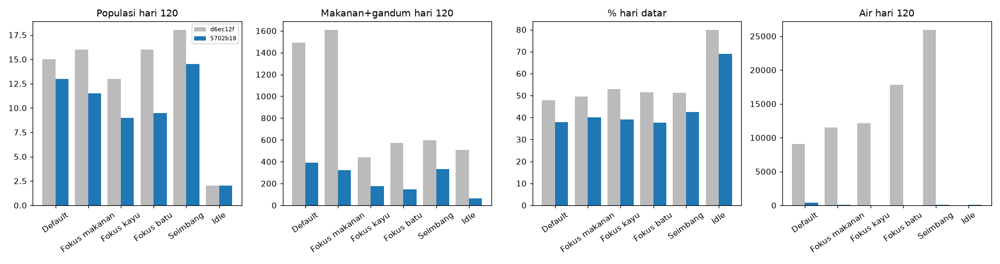

**Default**

| Metrik | d6ec12f | 5702b18 |
|---|---|---|
| Dusun (median hari, n tercapai) | 16.5 (30/30) | 37.5 (30/30) |
| Desa Pertanian | 61 (29/30) | 64 (27/30) |
| Kota Kecil | 86.5 (26/30) | 84.5 (22/30) |
| Populasi hari 60 / 120 | 5.5 / 15 | 5 / 13 |
| Makanan+gandum hari 120 | 1490 | 389 |
| Kayu hari 120 | 820 | 621 |
| Air hari 120 | 9038 | 359 |
| Kematian / run | 0 | 0.07 |
| Kepergian / run | 0 | 1.17 |
| Event / run | 22.4 | 27.23 |
| % hari datar | 47.9 | 37.8 |
| Rentang datar terpanjang (median) | 9 | 7 |
| % waktu penduduk menganggur | 2.6 | 14.8 |
| Run masih 2 penduduk di hari 40 | 3/30 | 12/30 |

**Seimbang**

| Metrik | d6ec12f | 5702b18 |
|---|---|---|
| Dusun (median hari, n tercapai) | 18 (30/30) | 19 (30/30) |
| Desa Pertanian | 43.5 (30/30) | 56 (26/30) |
| Kota Kecil | 73.5 (30/30) | 84 (19/30) |
| Populasi hari 60 / 120 | 8 / 18 | 7 / 14.5 |
| Makanan+gandum hari 120 | 596 | 331 |
| Kayu hari 120 | 659 | 431 |
| Air hari 120 | 25905 | 99 |
| Kematian / run | 0 | 0.07 |
| Kepergian / run | 0 | 1.07 |
| Event / run | 22.87 | 27.93 |
| % hari datar | 51.2 | 42.6 |
| Rentang datar terpanjang (median) | 9 | 6 |
| % waktu penduduk menganggur | 2.8 | 25.2 |
| Run masih 2 penduduk di hari 40 | 0/30 | 2/30 |

**Fokus kayu**

| Metrik | d6ec12f | 5702b18 |
|---|---|---|
| Dusun (median hari, n tercapai) | 42 (30/30) | 45.5 (30/30) |
| Desa Pertanian | 66 (29/30) | 70 (26/30) |
| Kota Kecil | 103 (27/30) | 102 (13/30) |
| Populasi hari 60 / 120 | 5 / 13 | 4 / 9 |
| Makanan+gandum hari 120 | 440 | 178 |
| Kayu hari 120 | 1074 | 373 |
| Air hari 120 | 12142 | 35 |
| Kematian / run | 0 | 0.1 |
| Kepergian / run | 0 | 1.43 |
| Event / run | 20.83 | 26.6 |
| % hari datar | 52.9 | 39.2 |
| Rentang datar terpanjang (median) | 10 | 7.5 |
| % waktu penduduk menganggur | 2.8 | 22.1 |
| Run masih 2 penduduk di hari 40 | 16/30 | 19/30 |

**Fokus makanan**

| Metrik | d6ec12f | 5702b18 |
|---|---|---|
| Dusun (median hari, n tercapai) | 17 (27/30) | 14 (30/30) |
| Desa Pertanian | 51 (27/30) | 62 (26/30) |
| Kota Kecil | 82 (27/30) | 86 (17/30) |
| Populasi hari 60 / 120 | 7 / 16 | 5 / 11.5 |
| Makanan+gandum hari 120 | 1606 | 324 |
| Kayu hari 120 | 834 | 2 |
| Air hari 120 | 11507 | 67 |
| Kematian / run | 0 | 0.03 |
| Kepergian / run | 0 | 2.83 |
| Event / run | 22.07 | 30 |
| % hari datar | 49.6 | 40 |
| Rentang datar terpanjang (median) | 9 | 6.5 |
| % waktu penduduk menganggur | 2.5 | 28.4 |
| Run masih 2 penduduk di hari 40 | 3/30 | 10/30 |

**Fokus batu**

| Metrik | d6ec12f | 5702b18 |
|---|---|---|
| Dusun (median hari, n tercapai) | 19 (30/30) | 20 (30/30) |
| Desa Pertanian | 56 (30/30) | 64 (24/30) |
| Kota Kecil | 84 (30/30) | 96 (15/30) |
| Populasi hari 60 / 120 | 7 / 16 | 5 / 9.5 |
| Makanan+gandum hari 120 | 570 | 145 |
| Kayu hari 120 | 890 | 7 |
| Air hari 120 | 17802 | 36 |
| Kematian / run | 0 | 0.17 |
| Kepergian / run | 0 | 2.53 |
| Event / run | 20.73 | 28.7 |
| % hari datar | 51.5 | 37.6 |
| Rentang datar terpanjang (median) | 9 | 7 |
| % waktu penduduk menganggur | 2.3 | 23.6 |
| Run masih 2 penduduk di hari 40 | 1/30 | 10/30 |

**Idle**

| Metrik | d6ec12f | 5702b18 |
|---|---|---|
| Dusun (median hari, n tercapai) | – (0/30) | – (0/30) |
| Desa Pertanian | – (0/30) | – (0/30) |
| Kota Kecil | – (0/30) | – (0/30) |
| Populasi hari 60 / 120 | 2 / 2 | 2 / 2 |
| Makanan+gandum hari 120 | 506 | 65 |
| Kayu hari 120 | 87 | 122 |
| Air hari 120 | 16 | 60 |
| Kematian / run | 0 | 0 |
| Kepergian / run | 0 | 0 |
| Event / run | 20.07 | 22.5 |
| % hari datar | 79.8 | 69 |
| Rentang datar terpanjang (median) | 16 | 14.5 |
| % waktu penduduk menganggur | 2.8 | 2.7 |
| Run masih 2 penduduk di hari 40 | 30/30 | 30/30 |

Ringkas: air sudah terkendali (9.038 → 359, `SPOILAGE.waterCapDays` 30 bekerja), stok pangan hari 120 turun ~4× (1.490 → 389), hari datar turun 47,9% → 37,8% (Default), dan kini ada kepergian (≈1–3 per run) serta kematian langka (0,03–0,17 per run). Tetapi **Dusun mundur dari hari 16,5 ke 37,5** (Default), lebih sedikit run mencapai Kota Kecil (26 → 22 dari 30), dan **waktu menganggur penduduk naik dari 2,6% ke 14,8–28,4%** — penyebab utamanya bug (v2.3).

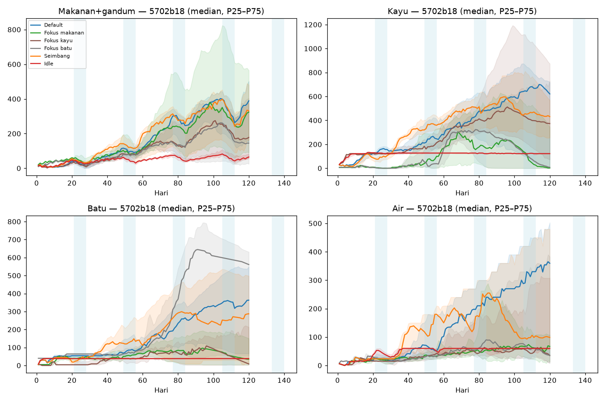
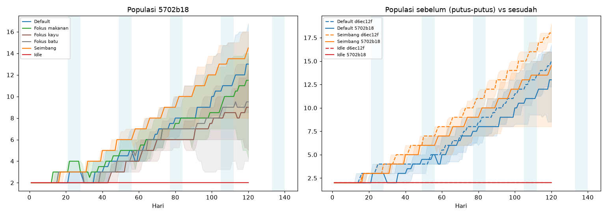
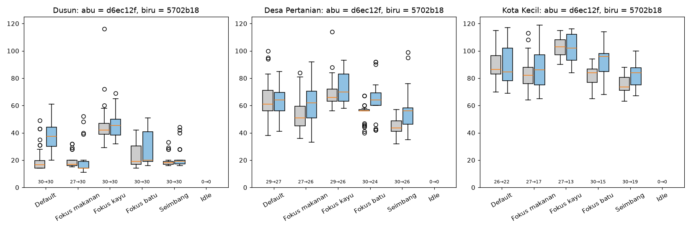
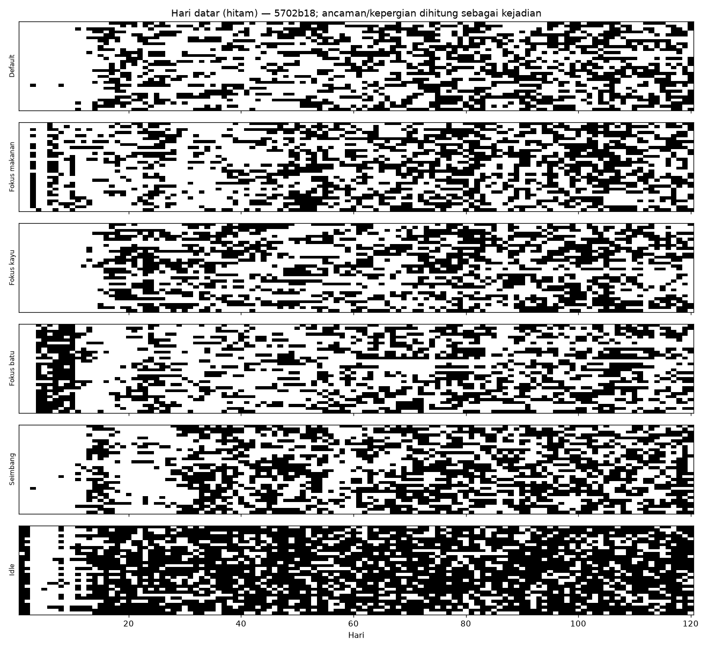

## v2.3 Temuan kritis: bug perbaikan bangunan (kode, bukan konstanta)

Di `game.js` (ada di d6ec12f, 5702b18 **dan** HEAD c0e08bf), cabang tugas `bangun` dimulai dengan `if (b.done || !S.buildings.includes(b)) { v.task = null; break; }`, sehingga cabang perbaikan (`if (b.done) { b.hp += ... }`) **tidak pernah tercapai**. `buildTask()` terus memilih bangunan rusak (`hp < BUILDING_DAMAGE.repairBelow` 80), tugas langsung di-null-kan, lalu dipilih lagi tiap langkah. Akibatnya:
- Bangunan rusak (kebakaran, badai, event `kesehatan_bangunan`) **tidak pernah diperbaiki**; Gubuk < `noCapacityBelow` 40 kehilangan kapasitas permanen.
- Penduduk berprioritas Bangun "macet" di depan bangunan rusak: contoh seed 2 fokus makanan, 234.536 pemilihan tugas berulang pada Bengkel hp 67 (hari 60–120). Inilah lonjakan menganggur 14,8–28,4%, dan juga penyebab run jadi lambat.
- Eksperimen B (hanya memperbaiki baris itu di salinan scratch, `!S.buildings.includes(b) || b.done && hp >= 100`): menganggur Default 14,8% → **3,3%**, kepergian 35 → **16**, Kota Kecil 22/30 → **30/30**, kayu tidak lagi habis (fokus makanan kayu hari 120: 2 → 716). **Ini perubahan berdampak terbesar; perlu diperbaiki oleh Asisten Koding.**

## v2.4 Pertanyaan 1 — Mengapa kematian masih (hampir) 0?

5702b18 asli: total 13 kematian dalam 150 run bot (0 di Idle): 10 karena "serangan → sakit parah", 1 serangan langsung, 1 kelaparan, 1 sakit parah. Seberapa dekat run dengan kematian:

| Pengaturan | Kesehatan min. (median / terendah) | Run dgn kesehatan < 40 | Hari stok pangan min. (median) | Hari stok 0 / run | Hari 'kolaps' / run | Malam serigala menyerang / run | Gigitan / run | Total damage gigitan / run | Sakit (baru) / run | Sakit parah / run | Kebakaran / run | Banjir / run | Hari mood rata2 < 35 / run |
|---|---|---|---|---|---|---|---|---|---|---|---|---|---|
| Default | 42 / 17.0 | 13/30 | 0.12 | 1.97 | 1.93 | 5.27 | 3.97 | 127 | 2.1 | 0.47 | 0.93 | 2.0 | 8.9 |
| Fokus makanan | 39 / 0.0 | 18/30 | 1.42 | 0.6 | 0.57 | 5.9 | 4.83 | 156 | 4.2 | 0.9 | 1.8 | 1.8 | 11.27 |
| Fokus kayu | 41 / 0.0 | 12/30 | 0.00 | 1.73 | 1.67 | 3.9 | 3.43 | 111 | 4.07 | 0.8 | 1.63 | 2.1 | 20.17 |
| Fokus batu | 38 / 0.5 | 16/30 | 0.31 | 1.57 | 1.57 | 4.77 | 3.77 | 121 | 3.8 | 0.67 | 1.53 | 2.53 | 12.87 |
| Seimbang | 36 / 0.5 | 16/30 | 0.50 | 0.6 | 0.57 | 5.77 | 4.87 | 158 | 2.93 | 1.0 | 1.43 | 2.3 | 2.57 |
| Idle | 100 / 69.8 | 0/30 | 1.00 | 0.6 | 0.43 | 0.0 | 0.0 | 0 | 7.13 | 0.13 | 0.0 | 2.27 | 113.97 |

| Pengaturan | Kematian (seed) | Kepergian (penyebab) | Run dengan kepergian | Pertahanan dibangun bot (rata2) |
|---|---|---|---|---|
| Default | serangan (sakit parah) 2 (seed 6, 23) | mood 35 | 15/30 | obor 3.0, pagar 4.0, menara 0.8 |
| Fokus makanan | serangan serigala 1 (seed 25) | mood 83, event 1, lapar 1 | 26/30 | obor 2.9, pagar 3.9, menara 0.6 |
| Fokus kayu | serangan (sakit parah) 1, kelaparan 1, sakit parah 1 (seed 3, 7, 20) | mood 43 | 18/30 | obor 3.0, pagar 4.0, menara 0.6 |
| Fokus batu | serangan (sakit parah) 5 (seed 13, 18, 20, 25, 27) | mood 74, lapar 2 | 26/30 | obor 3.0, pagar 4.0, menara 0.6 |
| Seimbang | serangan (sakit parah) 2 (seed 20, 26) | mood 32 | 13/30 | obor 3.0, pagar 4.0, menara 0.7 |
| Idle | 0 (seed –) | 0 | 0/30 | obor 0.0, pagar 0.0, menara 0.0 |

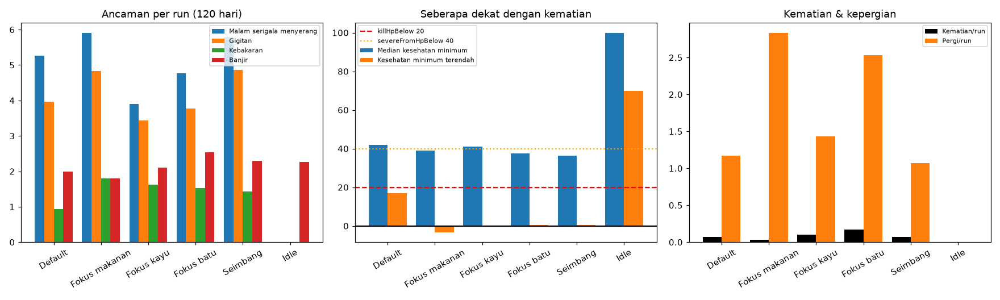

Penelusuran per jalur (angka dari 5702b18 asli, kecuali disebut lain):

1. **Kelaparan.** Kesehatan hanya turun `HEALTH.starvePerDay` 20/hari saat lapar = 0, jadi dari 100 butuh 5 hari penuh lapar 0. Sementara itu (a) penduduk makan setiap kali stok > 0 dan AI masuk mode darurat meramu saat stok < pop×3; (b) `LEAVE.starveDays` 2 membuat penduduk yang kelaparan **pergi** pada hari ke-3 sebelum sempat mati (selama pop > `LEAVE.minPop` 2). Hari stok 0 hanya 0,6–2 per run. Hasil: 1 kematian kelaparan dalam 150 run; jalur ini **diblokir oleh leave yang lebih cepat dan starvePerDay yang lambat**.
2. **Lapar musim dingin.** `WINTER_HUNGER_MULT` 2.0 memang membuat stok akhir Gugur tipis (median hari stok di hari 105: 7,5 Default, di bawah `YEAR_SCALE.winterBufferDays` 10), tapi darurat meramu + makan-saat-ada menahan lapar di atas 0. Tidak ada kematian "kelaparan dingin" di run asli.
3. **Serigala.** 3,4–4,9 gigitan/run, damage `THREAT.wolf.damage` [25,40] → total 111–158 hp/run. Namun gigitan **tidak bisa langsung membunuh**: kesehatan dijepit ke minimal 0,5 (tahun 2+) / 1 (tahun 1). Kematian langsung hanya bila tahun 2+, hp < `killHpBelow` 20, **tidak** dalam `killSafeRadius` 8 petak dari Pagar/Menara, dan lolos `killChanceIfLowHp` 0.10. Bot menaruh 4 Pagar di sekitar perkemahan, jadi radius 8 menutupi hampir seluruh desa → praktis tertutup (1 kematian langsung).
4. **Sakit parah.** Gigitan yang membuat hp < `SICKNESS.severeFromHpBelow` 40 → sakit parah (12–18 dari 30 run punya hp < 40). Tanpa dirawat, mati `severeDeathPerDay` 0.08/hari; tapi perawatan (prioritas `rawat` 3, biaya 5 makanan) hampir selalu terjadi hari itu juga. Ini jalur kematian utama (10 dari 13).
5. **Kepergian.** Jalur kehilangan penduduk yang dominan: 32–85 kepergian per 30 run, hampir semuanya karena mood (`LEAVE.moodBelow` 35 selama `days` 5). `LEAVE.minPop` 2 membuat desa tidak pernah kosong — dan karena itulah **Idle (2 penduduk) kebal**: tidak ada serigala yang menggigit di era Perkemahan (`minEra: 'dusun'`), tidak bisa pergi, sakit parah hanya 0,13/run dan selalu dirawat penduduk satunya.

**Eksperimen D (paket usulan, di atas perbaikan bug):** `THREAT.wolf.killChanceIfLowHp` 0.10→0.25, `THREAT.wolf.killSafeRadius` 8→4, `SICKNESS.severeDeathPerDay` 0.08→0.15, `HEALTH.starvePerDay` 20→30, `SPOILAGE.foodFreeDays` 20→16, `START_RES.kayu` 12→20. Hasil per 30 run: kematian Default 5 (5 run, 17%), Seimbang 3 (10%), Fokus kayu 5 (termasuk 2 kelaparan), Fokus batu 6, Fokus makanan 4, Idle 0. Progres tidak dirugikan (Seimbang: Desa Pertanian hari 43, Kota Kecil hari 73, 30/30). Catatan jujur: perbedaan antara main "buruk" dan "baik" masih kecil (5 vs 3), karena jalur kematian utama masih gigitan acak, bukan keputusan pemain.

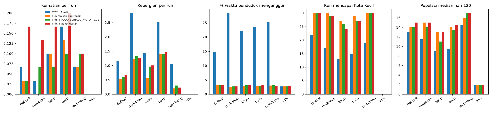

Skenario A–D, 30 seed per pengaturan, 120 hari ("Gubuk pertama maks" = hari paling lambat gubuk pertama selesai):

**Default**

| Skenario | Kematian (run terdampak) | Penyebab | Pergi | Menganggur % | Kota Kecil | Pop d120 | Pangan d120 (hari stok) | Busuk/run | Gubuk pertama maks | Pop=2 di d40 |
|---|---|---|---|---|---|---|---|---|---|---|
| A. 5702b18 asli | 2 (2/30) | serangan (sakit parah) 2 | 35 | 14.8 | 84 (22/30) | 13 | 389 (14.0) | 12.2 | 7 | 12/30 |
| B. + perbaikan bug repair | 1 (1/30) | serangan (sakit parah) 1 | 16 | 3.3 | 95 (30/30) | 14 | 500 (15.2) | 27.7 | 7 | 12/30 |
| C. B + FOOD_SURPLUS_FACTOR 1.25 | 1 (1/30) | serangan (sakit parah) 1 | 18 | 3.1 | 95 (30/30) | 14 | 511 (17.8) | 24.9 | 7 | 14/30 |
| D. B + paket usulan | 5 (5/30) | serangan (sakit parah) 4, sakit parah 1 | 20 | 3.2 | 94 (30/30) | 15 | 474 (15.4) | 41.1 | 7 | 10/30 |

**Seimbang**

| Skenario | Kematian (run terdampak) | Penyebab | Pergi | Menganggur % | Kota Kecil | Pop d120 | Pangan d120 (hari stok) | Busuk/run | Gubuk pertama maks | Pop=2 di d40 |
|---|---|---|---|---|---|---|---|---|---|---|
| A. 5702b18 asli | 2 (2/30) | serangan (sakit parah) 2 | 32 | 25.2 | 84 (19/30) | 14.5 | 331 (14.0) | 8.9 | 8 | 2/30 |
| B. + perbaikan bug repair | 2 (2/30) | serangan (sakit parah) 2 | 6 | 3.0 | 84 (30/30) | 16 | 505 (15.0) | 16.1 | 8 | 2/30 |
| C. B + FOOD_SURPLUS_FACTOR 1.25 | 3 (3/30) | serangan (sakit parah) 3 | 9 | 3.1 | 82 (30/30) | 17 | 595 (17.1) | 13.6 | 8 | 1/30 |
| D. B + paket usulan | 3 (3/30) | serangan (sakit parah) 3 | 7 | 2.8 | 73 (30/30) | 17 | 503 (14.6) | 24.0 | 14 | 0/30 |

**Fokus kayu (main buruk)**

| Skenario | Kematian (run terdampak) | Penyebab | Pergi | Menganggur % | Kota Kecil | Pop d120 | Pangan d120 (hari stok) | Busuk/run | Gubuk pertama maks | Pop=2 di d40 |
|---|---|---|---|---|---|---|---|---|---|---|
| A. 5702b18 asli | 3 (3/30) | serangan (sakit parah) 1, kelaparan 1, sakit parah 1 | 43 | 22.1 | 102 (13/30) | 9 | 178 (11.7) | 20.6 | 7 | 19/30 |
| B. + perbaikan bug repair | 3 (2/30) | kelaparan 1, serangan (sakit parah) 1, sakit parah 1 | 17 | 2.8 | 103 (27/30) | 13 | 450 (16.2) | 40.4 | 7 | 19/30 |
| C. B + FOOD_SURPLUS_FACTOR 1.25 | 2 (2/30) | kelaparan 1, serangan (sakit parah) 1 | 29 | 3.1 | 112 (26/30) | 11 | 463 (18.4) | 44.3 | 7 | 22/30 |
| D. B + paket usulan | 5 (5/30) | kelaparan dingin 1, kelaparan 1, serangan (sakit parah) 3 | 30 | 3.2 | 99 (24/30) | 13 | 442 (16.3) | 44.6 | 7 | 15/30 |

**Fokus makanan**

| Skenario | Kematian (run terdampak) | Penyebab | Pergi | Menganggur % | Kota Kecil | Pop d120 | Pangan d120 (hari stok) | Busuk/run | Gubuk pertama maks | Pop=2 di d40 |
|---|---|---|---|---|---|---|---|---|---|---|
| A. 5702b18 asli | 1 (1/30) | serangan serigala 1 | 85 | 28.4 | 86 (17/30) | 11.5 | 324 (14.1) | 49.9 | 23 | 10/30 |
| B. + perbaikan bug repair | 0 (0/30) | – | 37 | 2.6 | 87 (30/30) | 15 | 1101 (36.1) | 127.3 | 23 | 10/30 |
| C. B + FOOD_SURPLUS_FACTOR 1.25 | 2 (2/30) | serangan (sakit parah) 2 | 40 | 2.7 | 95 (29/30) | 14 | 1025 (35.9) | 107.1 | 39 | 10/30 |
| D. B + paket usulan | 4 (3/30) | serangan (sakit parah) 2, kesehatan/air 2 | 38 | 2.7 | 88 (29/30) | 15 | 1039 (35.0) | 162.8 | 29 | 8/30 |

**Fokus batu**

| Skenario | Kematian (run terdampak) | Penyebab | Pergi | Menganggur % | Kota Kecil | Pop d120 | Pangan d120 (hari stok) | Busuk/run | Gubuk pertama maks | Pop=2 di d40 |
|---|---|---|---|---|---|---|---|---|---|---|
| A. 5702b18 asli | 5 (5/30) | serangan (sakit parah) 5 | 76 | 23.6 | 96 (15/30) | 9.5 | 145 (10.1) | 6.8 | 19 | 10/30 |
| B. + perbaikan bug repair | 4 (4/30) | serangan (sakit parah) 4 | 42 | 2.8 | 96 (29/30) | 14 | 456 (15.2) | 22.5 | 19 | 10/30 |
| C. B + FOOD_SURPLUS_FACTOR 1.25 | 3 (2/30) | kesehatan/air 1, sakit parah 1, serangan (sakit parah) 1 | 42 | 2.8 | 96 (27/30) | 13.5 | 510 (17.3) | 13.3 | 38 | 18/30 |
| D. B + paket usulan | 6 (5/30) | serangan (sakit parah) 4, kelaparan dingin 1, kesehatan/air 1 | 44 | 3.2 | 95 (27/30) | 14.5 | 449 (15.2) | 21.9 | 19 | 7/30 |

**Idle (pasif)**

| Skenario | Kematian (run terdampak) | Penyebab | Pergi | Menganggur % | Kota Kecil | Pop d120 | Pangan d120 (hari stok) | Busuk/run | Gubuk pertama maks | Pop=2 di d40 |
|---|---|---|---|---|---|---|---|---|---|---|
| A. 5702b18 asli | 0 (0/30) | – | 0 | 2.7 | - (0/30) | 2 | 65 (16.3) | 20.0 | – | 30/30 |
| B. + perbaikan bug repair | 0 (0/30) | – | 0 | 2.7 | - (0/30) | 2 | 65 (16.3) | 20.0 | – | 30/30 |
| C. B + FOOD_SURPLUS_FACTOR 1.25 | 0 (0/30) | – | 0 | 2.7 | - (0/30) | 2 | 81 (20.2) | 21.7 | – | 30/30 |
| D. B + paket usulan | 0 (0/30) | – | 0 | 2.9 | - (0/30) | 2 | 63 (15.9) | 20.1 | – | 30/30 |


## v2.5 Pertanyaan 2 — Stok pangan akhir permainan

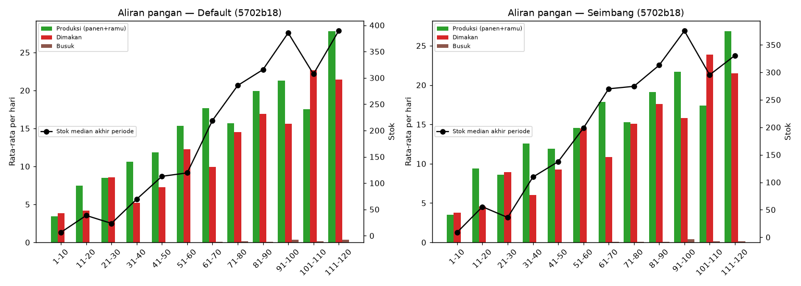

Aliran pangan Default (rata-rata per hari, 30 run; "dimakan" adalah estimasi dari kenaikan lapar, jadi tidak termasuk biaya event/perawatan):

| Hari | Produksi | Dimakan | Busuk | Stok median akhir periode | Pop median |
|---|---|---|---|---|---|
| 1-10 | 3.46 | 3.86 | 0.0 | 6.5 | 2.0 |
| 11-20 | 7.45 | 4.18 | 0.0 | 38.5 | 2.0 |
| 21-30 | 8.47 | 8.59 | 0.0 | 23.5 | 2.0 |
| 31-40 | 10.63 | 5.24 | 0.0 | 69.5 | 3.0 |
| 41-50 | 11.86 | 7.29 | 0.02 | 112.9 | 4.5 |
| 51-60 | 15.32 | 12.23 | 0.03 | 119.4 | 5.0 |
| 61-70 | 17.69 | 9.91 | 0.08 | 219.1 | 6.5 |
| 71-80 | 15.71 | 14.51 | 0.12 | 285.5 | 8.0 |
| 81-90 | 19.95 | 16.9 | 0.08 | 315.6 | 8.0 |
| 91-100 | 21.3 | 15.61 | 0.36 | 385.4 | 10.0 |
| 101-110 | 17.55 | 22.69 | 0.17 | 307.2 | 11.0 |
| 111-120 | 27.78 | 21.41 | 0.35 | 389.3 | 13.0 |

- Angka absolut 300–400 di hari 120 terutama karena **populasi 13–15**; dalam satuan hari stok, median hanya **14,0 hari** (Default, Seimbang) di hari 120 dan **7,5 hari** di akhir Gugur (hari 105). Surplus produksi musim tanam (+3 s.d. +8/hari) habis lagi di musim Dingin (hari 101–110: dimakan 22,7 vs produksi 17,6).
- Pembusukan nyaris tidak bekerja: ambang `SPOILAGE.foodFreeDays` 20 × `foodPerDay()` (≈ 520 makanan untuk 13 penduduk) hampir tidak pernah terlewati → busuk hanya 12 per run (Default) sepanjang 120 hari. Hanya Fokus makanan yang menimbun (36 hari stok di hari 120 setelah bug diperbaiki, busuk 127/run).
- Kesimpulan: **stok akhir Default tidak berlebihan**; justru akhir Gugur di bawah target 10 hari. Rekomendasi: jangan perketat konsumsi lagi; turunkan `SPOILAGE.foodFreeDays` 20 → **16** hanya untuk menekan penimbunan (diuji di D: busuk fokus makanan 127 → 163/run, Default 28 → 41/run; populasi dan era tidak turun). `SPOILAGE.foodPerDay` 0.02 biarkan.

## v2.6 Pertanyaan 3 — Softlock gubuk pertama

- Di 5702b18 asli, bot tidak pernah macet > 30 hari: gubuk pertama paling lambat hari 23 (fokus makanan, seed 13) dalam 150 run; sweep 100 seed fokus makanan × 45 hari (dengan perbaikan bug): median hari 12, P90 18,1, maks 23, 0 kasus > 30.
- **Reproduksi:** dengan `FOOD_SURPLUS_FACTOR` 1.25, 5 dari 100 seed macet > 30 hari: seed 13 (hari 39 — sama persis dengan laporan Koding), 31 (38), 43 (37), 33 (36), 3 (32); 16/100 lewat hari 20. Pada run 120 hari (C), Fokus batu juga macet (seed 14 hari 38, seed 2 hari 35).
- **Akar masalah** (terlihat di seed 13): dengan prioritas kayu 1, skor kayu (1×10) baru mengalahkan makanan (3×10) setelah stok pangan ≥ `pop × SPAWN.foodDaysPerPop × SPAWN.foodPerDayPerPop × FOOD_SURPLUS_FACTOR` (= 40 untuk 2 penduduk saat faktor 1.0, 50 saat 1.25) **dan** air ≥ `WATER_SURPLUS_DAYS` hari. Dua penduduk tidak sanggup menahan keduanya, dan event opsi pertama (mis. `festival_desa` −30 makanan, `anak_hilang` −5 kayu) mereset stok → kayu diam di 7 selama 14 hari.
- **Yang tidak menolong:** `START_RES.kayu` 20 (maks 29) dan `gudang.cost.kayu` 12 (maks 29); keduanya habis untuk Api Unggun/Gudang lebih dulu.
- **Usulan:** pertahankan `FOOD_SURPLUS_FACTOR` **1.0** (jangan dinaikkan). Fail-safe (kode): di `chooseTask`, bila `done('gubuk').length === 0` dan `S.day >= 6`, perlakukan kayu/batu sampai biaya Gubuk sebagai darurat (seperti darurat makanan `foodTotal() < pop*3`).

## v2.7 Rekomendasi numerik v2 (urut dampak)

1. **Perbaiki bug repair** (v2.3) — kode, bukan konstanta. Diuji (B): menganggur 14,8% → 3,3%, kepergian −54%, Kota Kecil 22 → 30 dari 30.
2. **Paket ancaman yang adil** (diuji di D): `THREAT.wolf.killChanceIfLowHp` **0.10 → 0.25**, `THREAT.wolf.killSafeRadius` **8 → 4** (pagar harus benar-benar dekat), `SICKNESS.severeDeathPerDay` **0.08 → 0.15**, `HEALTH.starvePerDay` **20 → 30**. Hasil: kematian pada 10–17% run (tidak nol), Idle tetap aman, progres tidak turun.
3. **`FOOD_SURPLUS_FACTOR` tetap 1.0** + fail-safe gubuk pertama (v2.6). Diuji: 1.25 → 5/100 softlock.
4. **`SPOILAGE.foodFreeDays` 20 → 16** (diuji di D) untuk menekan penimbunan; `foodPerDay` 0.02 tetap.
5. **Stagnasi 2 penduduk** (belum diuji): 10–12 dari 30 run Default masih 2 penduduk di hari 40 (asli dan B). Pada run yang macet, mood rata-rata hari 8–40 hanya ~51 vs ~70 pada run normal, dan stok ≥ 40 hanya 12% hari. Mood jatuh di Dingin pertama (contoh seed 1: 62 → 5 di hari 21–31) dan pulih lambat. Kandidat: `SPAWN.minMood` 65 → 55 atau `SEASON_FX.dingin.clothesMoodPerDay.tanpa` −8 → −5. Perlu run ulang.
6. **Agar main buruk lebih berisiko daripada main baik** (belum diuji): `LEAVE.starveDays` 2 → 4 supaya kelaparan bisa berujung kematian (bukan hanya pergi). Pertimbangkan juga `THREAT.wolf.minEra` tetap `dusun` agar pemula tetap aman (sesuai prinsip cozy).

## v2.8 Keterbatasan & catatan v2

- **Fitur reproduksi (RISET-SIKLUS-HIDUP) akan mengubah dinamika populasi** (kelahiran, tumbuh kembang, lansia). Stagnasi 2 penduduk, `SPAWN.*`, `LEAVE.minPop`, dan angka kematian di atas harus diukur ulang setelah fitur itu masuk; TEKS-GAME v1.3.0 di HEAD sudah memuat teksnya.
- HEAD repo (`c0e08bf`) sudah berbeda dari 5702b18 (236 berkas berubah); analisa ini hanya untuk 5702b18.
- Eksperimen B/C/D memakai salinan `game.js` yang dipatch di `/workspace/desa-analisa/snap-fix/` (hanya baris repair) dan override `CONFIG` saat runtime; bukan kode repo.
- Penyebab kematian diklasifikasi dari status penduduk sesaat sebelum mati (bukan dari string internal). "Dimakan" di aliran pangan adalah estimasi.
- Bot selalu memilih opsi event pertama yang aktif (sering yang mahal, mis. festival −30 makanan), tidak memakai Pasar, menaruh pertahanan dengan pola tetap di sekitar perkemahan, dan tidak mengubah prioritas (kecuali tombol modal kelaparan yang mengubah Makanan ke 3). Pemain nyata akan berbeda.
- Satu peta (seed peta tetap `rng(12345)`).
- Skrip: `sim2.js`, `analyze2.py`, `cmp.py`, `exp_chart.py`, `runexp.sh`; ringkasan `summary2.json`, `flow2.json`, `exp_metrics.json` di `/workspace/desa-analisa/`.

---

# v3 (440cd24)

*Putaran 3, 17 Okt 2026 (WIB/UTC+7), oleh Grok Bot. Isi putaran 1 dan v2 di atas tetap dipertahankan.*

## v3.1 Metode

- **Versi:** HEAD `440cd24` (berisi 43e9cc3 perbaikan repair/ancaman/gubuk dan 4cde541 siklus hidup/tidur/hubungan). Working tree repo berbeda (ada perubahan belum di-commit), jadi **tidak di-checkout**. Berkas `balance.js, tema.js, assets.js, audio.js, tech.js, game.js, index.html, TEKS-GAME.json` diambil via `git show 440cd24:<path>` ke `/workspace/desa-analisa/snap-440cd24/`. Di repo hanya bagian ini dan `docs/analisa/*-r3.png` yang ditambahkan.
- **Harness `sim3.js`** (turunan sim2): `game.js` asli di jsdom, `step(0.1)`, RNG ber-seed, tema bawaan **indonesia** (4 musim hujan/mareng/kemarau/labuh, ancaman malam babi hutan, jadwal tidur 21:00–05:00, kerja siang ×1.35). Tambahan instrumentasi:
  - Siklus hidup: pasangan pertama, hamil pertama, lahir pertama, jumlah lahir, pendatang, bayi hilang, kematian tua (`S.deathsOld`).
  - Klasifikasi **hambatan harian** menuju kehamilan pertama memakai syarat yang sama dengan `pregnancyOk`. Kategorinya: tak ada lawan jenis dewasa, hubungan < 50, mood < 65 untuk berpasangan, menunggu peluang berpasangan, atau sudah berpasangan tetapi gagal syarat hamil (era < Dusun, usia ibu, mood < 70, stok < 7 hari, famine, kapasitas rumah, HP < 70, sakit) atau sudah memenuhi syarat dan tinggal menunggu peluang harian.
  - Bot kini juga membangun `rumah` (kapasitas 4) setelah bengkel bila ada pasangan yang belum serumah atau kapasitas ≤ pop+1.
- **Run utama:** 6 setelan (default, makanan, kayu, batu, seimbang, idle) × **40 seed** × 120 hari = **240 run** pada 440cd24 apa adanya. Ditambah **240 run** yang sama dengan perbaikan 1 baris (lihat v3.2) di salinan scratch `snap-440cd24-fix`.
- **What-if:** 11 varian × 4 setelan (default, makanan, kayu, seimbang) × **30 seed** (seed 1–30) = 1.320 run. Batu dan idle dilewati demi waktu, karena setiap varian makan 4–10 menit. Satu varian (SPAWN.minMood 55 tanpa fix) dihentikan karena waktu dan tidak dilaporkan. Total putaran 3: **±1.800 run**. Semua override diterapkan saat runtime ke salinan scratch, bukan ke repo.
- **Perbandingan dengan v2:** v2 = `out2` (5702b18, masih ada bug repair) dan "v2 + paket" (5702b18 + perbaikan repair + paket kematian teruji, ≈ isi 43e9cc3). Keduanya memakai tema 4 musim dengan serigala dan 30 seed. Jadi perbandingan v2→v3 juga mencakup **ganti tema** (lihat v3.9).

## v3.2 Temuan kritis: semak berhenti tumbuh permanen (bug kode, tema Indonesia)

`game.js` baris 1256 (440cd24, juga masih ada di working tree saat analisa ini):

```js
(n.regrow -= dt / (isRaining() ? FX().rainBushRegrowMult : 1))
```

Musim **labuh** punya `rainChance: 0.30` tetapi **tidak punya** `rainBushRegrowMult`. Pada hari hujan di labuh, pembaginya `undefined`, sehingga `n.regrow` menjadi `NaN`, dan `NaN <= 0` selalu false. Akibatnya setiap semak yang sedang habis saat hujan labuh **tidak akan pernah tumbuh lagi**. Kerusakan ini menumpuk setiap tahun:

- Seed 29 (default): jumlah semak `regrow=NaN` = 0 pada hari 21, lalu 10 pada hari 28, 23 pada hari 56, dan **30/30** pada hari 84.
- Setelah itu pangan hanya dari ladang. Produksi turun ke 0–8/hari, stok 0 mulai hari 98, dan 6 dari 7 penduduk mati kelaparan pada hari 104–110.
- Tema `sedang` aman: satu-satunya musim hujannya (`semi`) punya nilainya.

**Perbaikan (rekomendasi #1, teruji):** `(isRaining() ? (FX().rainBushRegrowMult || 1) : 1)`, atau tambahkan `rainBushRegrowMult: 1` ke `SEASON_FX.labuh` di `tema.js`. Uji 240 run dengan fix di salinan scratch:

| Metrik (40 seed) | default asli → fix | makanan | kayu | batu | seimbang |
|---|---|---|---|---|---|
| Kematian kelaparan total | 30 → 1 | 29 → 0 | 11 → 0 | 41 → 0 | 14 → 0 |
| Run dengan ≥3 hari stok pangan 0 (hari ≥60) | 8 → 0 | 8 → 0 | 8 → 0 | 10 → 0 | 4 → 0 |
| Kepergian / run | 0,32 → 0 | 0,48 → 0,05 | 0,35 → 0,02 | 0,90 → 0,05 | 0,22 → 0 |
| Median pop hari 120 | 10 → 14 | 13 → 16 | 11 → 13 | 12 → 14,5 | 13 → 15 |
| Median lahir pertama | 64 → 44,5 | 45 → 43,5 | 63 → 48 | 44 → 47 | 42 → 40 |
| Kota Kecil tercapai | 13/40 → 38/40 | 23 → 35 | 21 → 37 | 21 → 40 | 28 → 39 |

Pada versi asli, kematian kelaparan muncul sebagai **gelombang di akhir permainan**: median hari kematian lapar pertama 77–104. Ini terjadi setelah semak habis, bukan karena tuning `starvePerDay`. Dengan bug ini, hampir semua angka populasi dan kelahiran di 440cd24 asli bias ke bawah. Karena itu **analisa kelahiran dan what-if di bawah memakai versi fix sebagai dasar**.

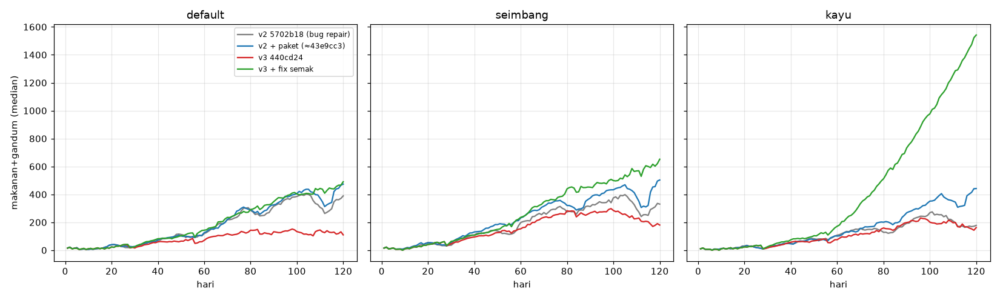

## v3.3 (a) Kelahiran pertama

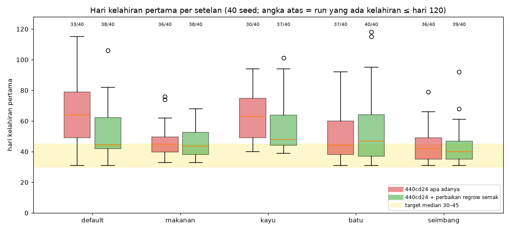

| Setelan (40 seed) | Lahir ≤ hari 120 | Median lahir pertama (p25–p75) | Median pasangan pertama | Median hamil pertama | Median Dusun |
|---|---|---|---|---|---|
| default asli | 33/40 | 64 (49–79) | 23 | 59 | 36,5 |
| default fix | 38/40 | 44,5 (42–62) | 23 | 38 | 28 |
| makanan fix | 38/40 | 43,5 (38–53) | 26 | 37 | 23 |
| kayu fix | 37/40 | 48 (44–64) | 33 | 41 | 33,5 |
| batu fix | 40/40 | 47 (37–64) | 26,5 | 40 | 23 |
| seimbang fix | 39/40 | 40 (35–47) | 19,5 | 33 | 23 |
| idle | 0/40 | – | – | – | – |

Median dihitung dari run yang ada kelahirannya. Kelahiran paling awal di **semua** setelan adalah hari **31**. Ini lantai struktural: Dusun paling cepat sekitar hari 23, ditambah peluang harian, ditambah `lengthDays` 7.

**Rantai hambatan** (persentase hari-alasan sebelum hamil pertama, versi fix; satu hari bisa punya >1 alasan):

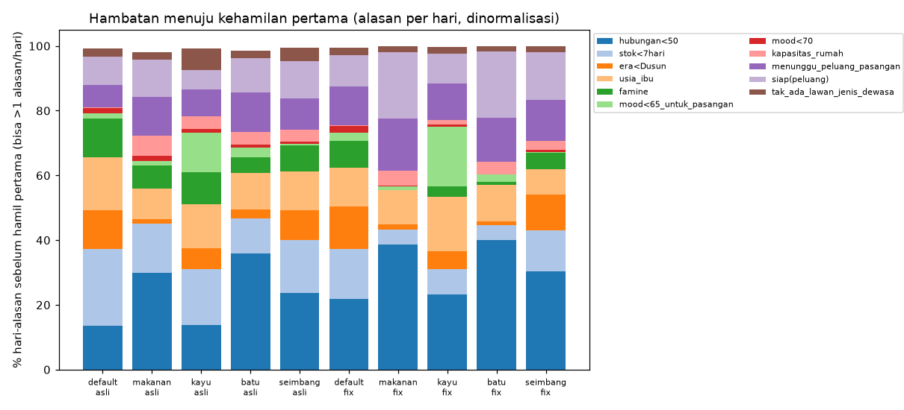

| Alasan | default | makanan | kayu | batu | seimbang |
|---|---|---|---|---|---|
| hubungan < 50 | 28,9 | 39,9 | 26,0 | 41,5 | 36,6 |
| stok < 7 hari | 20,2 | 4,8 | 9,0 | 4,7 | 15,3 |
| era < Dusun | 17,4 | 1,5 | 6,2 | – | 13,6 |
| usia ibu > 45 | 15,7 | 10,9 | 18,8 | 11,7 | 9,4 |
| menunggu peluang pasangan (15%/hari) | 15,7 | 16,6 | 12,6 | 14,1 | 15,2 |
| siap, menunggu peluang hamil (10%/hari) | 12,9 | 21,1 | 10,4 | 21,1 | 17,8 |
| famine (bukan aman/waspada) | 10,9 | – | 3,7 | – | 6,0 |
| mood < 65 untuk berpasangan | 3,5 | – | 20,6 | 2,6 | – |

Urutannya:

1. **Hubungan** butuh sekitar 1–3 minggu untuk naik 25 → 50 (pendiri), dan lebih lama untuk pendatang yang mulai dari 0.
2. **Peluang berpasangan** harian.
3. **Gerbang era Dusun dan stok ≥7 hari.** Ini dominan di default (makanan prio 2, Dusun median 28) dan kayu (Dusun 33,5).
4. **Peluang hamil** 10%/hari.

Faktor kelima yang khas versi ini adalah **penuaan**. Dengan `AGE.daysPerYear` 3,5, ibu pendiri yang mulai di usia 30-an melewati batas 45 sekitar hari 35–50. Kalau kehamilan belum terjadi, pasangan pendiri gugur dari jendela subur dan sistem harus menunggu pendatang.

Kapasitas rumah, HP, dan sakit hampir tidak pernah menjadi hambatan (≤5%).

**What-if kelahiran** (fix + override, 4 setelan × 30 seed; "gabungan" = median 120 run dengan run tanpa kelahiran dihitung 999):

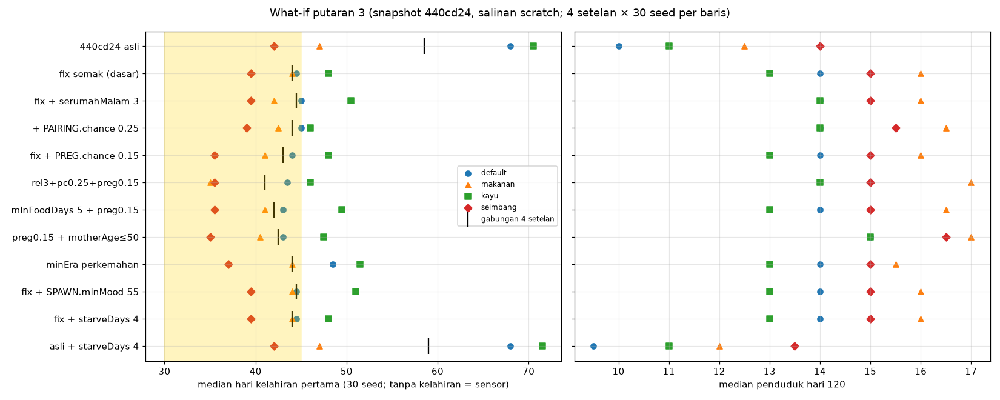

| Varian (di atas fix) | Gabungan | default | makanan | kayu | seimbang | Pop120 med (max) def/mak/kay/sei | Lahir/run def/mak/kay/sei |
|---|---|---|---|---|---|---|---|
| dasar fix | 44,0 | 44,5 | 44,0 | 48,0 | 39,5 | 14/16/13/15 (22) | 2,53/3,00/2,10/3,03 |
| `RELATION.gain.serumahMalam` 2→3 | 44,5 | 45,0 | 42,0 | 50,5 | 39,5 | 14/16/14/15 (24) | 3,10/3,93/2,70/3,93 |
| + `PAIRING.chancePerDay` 0,15→0,25 | 44,0 | 45,0 | 42,5 | 46,0 | 39,0 | 14/16,5/14/15,5 (21) | 3,37/4,10/2,97/3,67 |
| `PREGNANCY.chancePerDay` 0,10→0,15 | 43,0 | 44,0 | 41,0 | 48,0 | 35,5 | 14/16/13/15 (21) | 2,87/3,40/2,43/3,17 |
| **serumah 3 + pairing 0,25 + hamil 0,15** | **41,0** | 43,5 | 35,0 | 46,0 | 35,5 | 15/17/14/15 (21) | 3,70/4,33/3,53/3,80 |
| `PREGNANCY.minFoodDays` 7→5 + hamil 0,15 | 42,0 | 43,0 | 41,0 | 49,5 | 35,5 | 14/16,5/13/15 (21) | 2,73/3,53/2,37/3,30 |
| hamil 0,15 + `motherAge` [18,50] | 42,5 | 43,0 | 40,5 | 47,5 | 35,0 | 15/17/15/16,5 (24) | 3,73/4,60/3,53/4,63 |
| `PREGNANCY.minEra` 'perkemahan' | 44,0 | 48,5 | 44,0 | 51,5 | 37,0 | 14/15,5/13/15 (22) | 2,50/2,83/2,13/3,07 |

Kesimpulan (a):

- **Penyebab utama "lahir pertama ~51" adalah bug semak.** Dengan fix, median per setelan sudah 40–48 dan gabungan 44, tepat di batas atas target.
- Menaikkan hubungan saja (`serumahMalam` 3) **tidak** mempercepat kelahiran pertama. Efeknya hanya menambah jumlah kelahiran (+0,6–0,9/run).
- Kombinasi **serumahMalam 3 + PAIRING.chancePerDay 0,25 + PREGNANCY.chancePerDay 0,15** memberi gabungan **41**. Makanan dan seimbang turun ke ~35. Populasi tidak meledak: median pop hari 120 naik ≤1, maksimum 21 (dasar 22).
- Default (~43,5) dan kayu (~46) tetap tertahan gerbang Dusun dan stok, bukan oleh peluang.
- `minEra 'perkemahan'` **lebih buruk** (default 48,5). Sebabnya, `newcomerCooldownMult` 1,5 ikut aktif sejak awal (game.js 1286), sehingga pendatang lebih jarang dan kandidat pasangan lebih sedikit. Tidak disarankan.
- Median 30–35 untuk semua setelan tidak tercapai dengan parameter peluang saja, karena lantai struktural ~31.

## v3.4 (b) Alur penduduk & populasi

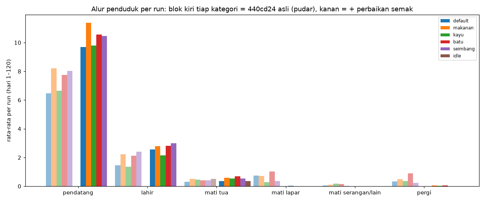

Rata-rata per run (40 seed, hari 1–120):

| Setelan | Pendatang asli/fix | Lahir asli/fix | Mati tua asli/fix | Mati lapar asli/fix | Mati serangan asli/fix | Pergi asli/fix |
|---|---|---|---|---|---|---|
| default | 6,48 / 9,70 | 1,45 / 2,55 | 0,30 / 0,35 | 0,75 / 0,03 | 0,05 / 0 | 0,32 / 0 |
| makanan | 8,20 / 11,38 | 2,22 / 2,80 | 0,50 / 0,60 | 0,73 / 0 | 0,10 / 0 | 0,48 / 0,05 |
| kayu | 6,65 / 9,80 | 1,35 / 2,15 | 0,45 / 0,55 | 0,28 / 0 | 0,18 / 0 | 0,35 / 0,02 |
| batu | 7,75 / 10,55 | 2,12 / 2,82 | 0,40 / 0,70 | 1,03 / 0 | 0,15 / 0 | 0,90 / 0,05 |
| seimbang | 8,02 / 10,45 | 2,40 / 3,00 | 0,40 / 0,55 | 0,35 / 0 | 0,03 / 0 | 0,22 / 0 |
| idle | 0 / 0 | 0 / 0 | 0,52 / 0,35 | 0 / 0 | 0 / 0 | 0 / 0 |

Catatan tabel:

- "Mati serangan" adalah babi hutan, ditambah 1 kasus "serangan (sakit parah)" di makanan dan kayu (asli). Semua kematian serangan terjadi saat penduduk sudah lemah karena kelaparan (versi asli). Di versi fix: 0.
- Pertumbuhan masih **didominasi pendatang**: sekitar 9,7–11,4 pendatang vs 2,2–3,0 kelahiran per run (fix). Median anak (<16 tahun) di hari 120 adalah 1–2.
- **Mati tua** kini sebab kematian utama di versi fix. Ada di 12–23 dari 40 run per setelan. Paling awal hari 76, median hari 112 (124 kematian tua di 240 run fix).
- Di **idle**, penduduk median turun ke **1** pada hari 120 (asli) atau tetap 2 (fix). Penyebabnya, 14–21 dari 40 run kehilangan pendiri karena usia tua. Ini sinyal "kalah pelan-pelan" yang wajar untuk permainan pasif.

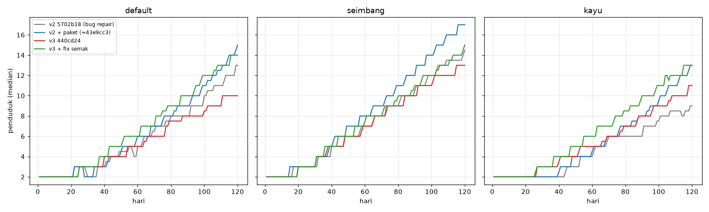

Populasi v2 → v3 (median):

| | v2 (5702b18) | v2 + paket | v3 asli | v3 fix |
|---|---|---|---|---|
| Pop hari 60 default/seimbang | 5 / 7 | 6 / 8 | 5 / 7 | 6 / 7,5 |
| Pop hari 120 default/makanan/kayu/batu/seimbang | 13/11,5/9/9,5/14,5 | 15/15/13/14,5/17 | 10/13/11/12/13 | 14/16/13/14,5/15 |
| Run pop ≤2 di hari 40 (default/kayu) | 12/30, 19/30 | 10/30, 15/30 | 1/40, 2/40 | 1/40, 0/40 |

Kemacetan populasi di 2 dari v2 hampir hilang. Pengaman gubuk dan pendatang awal kini bekerja: gubuk pertama paling lambat hari 4–16 di semua setelan non-idle. Populasi akhir v3 fix setara v2+paket (tidak overshoot).

## v3.5 (c) Perlu ubah SPAWN.minMood dan LEAVE.starveDays?

| Varian (4 setelan × 30 seed) | Gabungan lahir | Pendatang/run def/mak/kay/sei | Pergi/run | Mati non-tua/run |
|---|---|---|---|---|
| dasar fix | 44,0 | 9,70/11,37/9,87/10,43 | 0–0,07 | 0–0,03 |
| fix + `SPAWN.minMood` 65→55 | 44,5 | 9,37/11,47/9,83/10,43 | 0–0,10 | 0–0,03 |
| fix + `LEAVE.starveDays` 2→4 | 44,0 | 9,70/11,37/9,83/10,43 | 0–0,07 | 0–0,03 |
| asli | 58,5 | 6,43/8,17/6,63/8,27 | 0,20–0,53 | 0,30–1,00 |
| asli + `LEAVE.starveDays` 4 | 59,0 | 6,47/8,23/6,53/8,27 | 0,07–0,33 | 0,37–1,23 |

- **SPAWN.minMood 55: tidak perlu.** Alasan awalnya (pop macet di 2 karena mood jatuh di musim dingin pertama) sudah tidak terjadi (pop ≤2 di hari 40: 0–1/40). Uji menunjukkan pendatang tidak berubah (±0,3/run).
- **LEAVE.starveDays 4: tidak disarankan.** Dengan fix, hampir tidak ada yang kelaparan, jadi efeknya 0. Tanpa fix, kepergian memang turun (default 0,37 → 0,07), tetapi kematian non-tua **naik** (default 1,00 → 1,20, makanan 0,83 → 1,23). Penduduk yang tadinya pergi justru tinggal dan mati lapar. Pertahankan 2.

## v3.6 (d) Perbaikan repair & tuning ancaman

- **Repair:** waktu menganggur 14,8–28,4% (v2) turun ke **5,4–6,3%** (v3, asli maupun fix). Kepergian 1,07–2,83/run (v2) turun ke 0,22–0,90 (v3 asli) dan ~0 (fix). Perbaikan berhasil.
  - Sisa idle v3 sedikit di atas v2+paket (2,7–3,2%). Komposisi waktu penduduk default: tidur 31,5%, kumpul 30,1%, setor 16,9%, air 11,0%, kosong 3,4%, main 2,4%, libur 1,1%.
  - Jadi sisa idle didominasi tugas `null` singkat dan libur. Tidak ada pola loop.
- **Ancaman (babi hutan):**
  - Malam babi sekitar 9–11 per run (v2 serigala ~7–8). Gigitan/serudukan hanya **1,05–1,80/run** dengan total damage 23–31 HP/run (v2: 3,4–4,9 gigitan, 110–160 HP).
  - HP minimum median 73–80 (v2: 36–42). Sakit baru hampir hilang: 0–0,4/run vs 2–4/run di v2, kecuali idle 4,6/run.
  - Run dengan kematian non-tua di versi fix: default 1/40, lainnya **0/40**. Di versi asli 5–14/40, tetapi hampir semuanya kelaparan akibat bug semak.
  - **Selisih main buruk vs baik praktis hilang.** Idle tidak pernah diserang (0 gigitan) dan tidak mati selain karena usia. Bot yang baik pun tidak mati.
  - Target v2 ("kematian kecil tapi tidak nol untuk main pasif/buruk") **belum tercapai** di tema Indonesia.

## v3.7 (e) Tidur

- Tidur 21:00–05:00 memakan 31,5% waktu penduduk. Kompensasi ×1,35 cukup: pangan, era, dan populasi versi fix setara v2+paket.
  - Dusun default 28 (v2+paket 34), Kota Kecil 38/40.
  - Idle tidak naik karena tidur (tidur tidak dihitung idle).
- Ancaman malam hampir tidak mengenai penduduk karena mereka di dalam rumah. Babi kebanyakan menyerang ladang. Tidak ada kematian serangan di versi fix.
- Ini aman (tidak ada yang rusak), tetapi membuat malam nyaris tanpa risiko (lihat v3.6).
- Hari datar ("membosankan"): 31–40% pada setelan aktif (v2 37–43%), idle 63–66%.

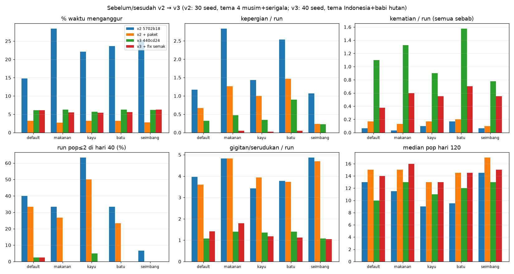

## v3.8 Rekomendasi numerik v3 (urut dampak)

1. **[TERUJI, 240+240 run] Perbaiki NaN regrow semak:** `game.js` baris 1256 jadi `(FX().rainBushRegrowMult || 1)`, atau `tema.js` `SEASON_FX.labuh.rainBushRegrowMult: 1`. Hasil: kematian lapar 125 → 1 (200 run aktif), lahir pertama default 64 → 44,5, pop120 +2–3.
2. **[TERUJI, 120 run] Kelahiran pertama:** `PREGNANCY.chancePerDay` 0,10 → **0,15**, `PAIRING.chancePerDay` 0,15 → **0,25**, `RELATION.gain.serumahMalam` 2 → **3**. Gabungan median 44 → **41** (makanan 35, seimbang 35,5, default 43,5, kayu 46). Pop120 naik ≤1, max 21, 120/120 run punya kelahiran.
   - Versi minimal: hanya `PREGNANCY.chancePerDay` 0,15 (gabungan 43).
3. **[TERUJI, 120 run, opsional] `PREGNANCY.motherAge` [18,45] → [18,50]** (bersama hamil 0,15). Kelahiran/run naik sekitar +1 (2,5 → 3,7 default) dan semua run punya kelahiran. Pop120 +1–1,5, max 24. Ini mengurangi efek "pendiri menua sebelum sempat punya anak". Alternatif yang belum diuji: `AGE.daysPerYear` 3,5 → 5.
4. **[TERUJI] Jangan ubah `SPAWN.minMood` (65) dan `LEAVE.starveDays` (2)**, lihat v3.5. **Jangan** ubah `PREGNANCY.minEra` ke 'perkemahan' (lebih lambat).
5. **[BELUM DIUJI] Surplus pangan akhir permainan kembali setelah fix:** median stok hari 120 di makanan 1.799 (59 hari) dan kayu 1.542 (58 hari), dengan busuk 481 dan 270/run. Pertimbangkan `SPOILAGE` lebih kuat untuk stok > ~30 hari, atau batasi `NODE_AMOUNT.makanan`/regrow semak di era lanjut. Uji ulang setelah fix #1 masuk.
6. **[BELUM DIUJI] Risiko malam untuk main pasif:** bila kematian kecil memang diinginkan, misalnya `THREAT.babi.damage` [15,30] → [20,35], atau biarkan babi melukai penduduk yang tidur di luar / tanpa pagar sejak era perkemahan. Saat ini damage total ~25 HP/run tidak pernah membawa HP ke bawah `killHpBelow` 20.

## v3.9 Keterbatasan & catatan v3

- **Ganti tema:** v2 diukur dengan tema 4 musim + serigala, v3 dengan tema Indonesia + babi (bawaan). Perbedaan ancaman/sakit sebagian karena tema, bukan hanya tuning. Run `TEMA=sedang` tidak dilakukan karena waktu.
- **Peta tunggal:** seed peta di game tetap (`rng(12345)`), jadi semua run memakai peta yang sama. Seed hanya mengubah RNG perilaku dan event.
- **Bot disederhanakan:** urutan bangun tetap, event selalu opsi pertama, prioritas tidak diubah dinamis (kecuali tombol modal kelaparan). Pemain nyata bisa lebih cepat ke Dusun, yang menggeser lahir pertama lebih awal.
- What-if hanya 4 setelan × 30 seed (batu dan idle tidak), karena satu varian butuh 4–10 menit. Median per setelan dari 30 seed punya ketidakpastian sekitar ±3 hari, jadi selisih <3 hari antar varian sebaiknya dianggap setara.
- Median lahir pertama per setelan dihitung dari run yang ada kelahirannya (tabel v3.3); kolom "gabungan" di what-if menghitung run tanpa kelahiran sebagai 999.
- Klasifikasi sebab kematian dan hambatan adalah rekonstruksi harness dari status penduduk, bukan log game.
- Working tree repo sudah lebih baru dari 440cd24 (belum di-commit). Bug semak masih ada di working tree saat analisa ini ditulis.
- Skrip & data: `/workspace/desa-analisa/` (`sim3.js`, `lc.py`, `wisum.py`, `analyze3.py`, `exp3_chart.py`, `ss3.py`, `out3/`, `out3-fix/`, `wi3-*/`, `snap-440cd24/`, `snap-440cd24-fix/`).

# v4 (3bbeca1) ringkas

Simulasi headless kode asli dari snapshot `git show 3bbeca1:*` (`/workspace/desa-analisa/snap-3bbeca1/`, skrip `sim5.js`). Tema Nusantara (bawaan), setelan **default**, 120 hari, **n = 10 seed per varian** (seed 1–10). Bot menjalankan aksi P1 seperti `balance-sim.test.js` (bayar keinginan bila stok > 8 hari, tahap monumen bila > 10, kerja bakti bila > 6). "Bahagia %" = `happyActiveDays / hari`. Varian = override CONFIG di salinan scratch, bukan perubahan kode game.

**1) Desa bahagia (target 25–45 % hari)**

| Varian (default, n=10) | Bahagia % median (p25–p75) | Run di 25–45 | Pendatang/run | Pop d120 |
|---|---|---|---|---|
| Baseline 3bbeca1 | 53.8 (45.0–57.1) | 3/10 | 6.3 | 10.5 |
| Ulang baseline (seed sama) | 56.3 (45.2–61.6) | 3/10 | 6.9 | 11.0 |
| MONUMENTS.enabled = false | 58.8 (51.3–63.2) | 1/10 | 7.5 | 12.0 |
| comfortPerStage 0 | 50.8 | 3/10 | 6.8 | 10.5 |
| passiveMoodMult 0 | 54.6 | 2/10 | 6.4 | 10.5 |
| pentasReog.mood 0 | 54.2 | 1/10 | 6.6 | 11.0 |
| Kerja bakti mood 0 | 53.8 | 1/10 | 6.5 | 11.0 |
| Kenduri mood 0 | 54.2 | 0/10 | 6.4 | 10.0 |
| WISHES.moodMult 0 | 50.8 | 2/10 | 6.4 | 10.0 |
| Semua efek mood monumen 0 | 55.9 | 3/10 | 7.1 | 11.0 |
| MOOD_COMFORT.base 62 | 52.5 (39.7–56.5) | 3/10 | 6.3 | 11.0 |
| **MOOD_COMFORT.base 61** | **43.7 (33.4–48.9)** | 5/10 | 6.5 | 10.5 |
| SPAWN.happy.days 7 | 49.6 (41.0–56.1) | 4/10 | 7.0 | 12.0 |
| **SPAWN.happy.mood 82** | **37.0 (32.6–47.3)** | 5/10 | 6.8 | 12.0 |

Temuan: di bot ini **tidak ada efek monumen yang menaikkan hari bahagia**. Semua ablasi tetap di 51–59 %, dan mematikan monumen sama sekali justru 58.8 %. Dua run baseline dengan seed sama berbeda 2.5 poin, jadi noise sekitar ±3. Angka 59 % vs 34 % dari Koding tidak terulang. Penyebab tingginya ada di luar monumen: batas nyaman mood warga berpasangan yang punya rumah (63+6+2+4+2+2 = 79) sudah hampir menyentuh ambang `SPAWN.happy.mood` 80.

**2) Babi hutan** (efek gagal pertahanan, default vs nodef = tanpa pagar/obor/menara; idle tidak punya ladang/korban yang relevan: 0 gigitan)

| Varian (n=10) | Run ada kematian serangan: default / nodef | Wipe | Mati tahun-1 non-tua | Gigitan/run (default) | Kerusakan HP/run | HP min median |
|---|---|---|---|---|---|---|
| Baseline 3bbeca1 | 0/10 / 0/10 | 0 | 0 | 1.9 | 41 | 76 |
| bb-b: damage [30,50], killHpBelow 70, killChanceIfLowHp 0.3 | **2/10 / 3/10** | 0 | 0 | 2.5 | 92 | 55 |
| bb-c: bb-b + baseNightChance 0.10 | **1/10 / 4/10** | 0 | 0 | 2.1 | 81 | 57 |
| bb-d: bb-c + injureFromEra 'desa_pertanian' | 0/10 / 3/10 | 0 | 0 | 1.6 | 65 | 55 |
| bb-a: damage [30,50], killHpBelow 50, kill 0.3, night 0.10 | 0/10 / 2/10 | 0 | 0 | 2.6 | 106 | 54 |

**3) Stok akhir (default, n=10)**: median makanan+gandum d120 = **326** (target 300–500, masuk) = 16.6 hari stok. Kayu 460, batu 242, air 315. Busuk ~10/run. Kenduri adalah sink terbesar setelah dimakan (≈334 makanan/run pada hari 60–120). Uji kenduri off (`surplusFrac 0`) membuat makanan d120 naik ke 653, sementara pendatang hampir tidak berubah (7.2 vs 6.3/run). Jadi kenduri tidak menghambat pendatang. Syarat pendatang di kode adalah 12 hari stok, bukan 20. Spoilage tidak diuji karena sudah sesuai target.

**Rekomendasi**
- Bahagia: `SPAWN.happy.mood` 80→82 (**teruji, n=10**: 37 %), atau `MOOD_COMFORT.base` 63→61 (**teruji, n=10**: 43.7 %, lebih dekat batas atas). Mengubah efek monumen tidak perlu (**teruji, n=10 per ablasi**: tanpa efek).
- Babi: bb-c (≈10 % run, **teruji n=10**) atau bb-b (≈20 % run, **teruji n=10**). Keduanya 0 wipe dan 0 kematian tahun-1, karena HP tahun-1 dikunci ≥1 dan kill butuh `isY2()`. Pemain tanpa pertahanan kena 30–40 % run.
- Pangan: tidak ada perubahan (**terukur n=10**).

**Catatan**: n = 10 seed per varian, jadi selisih <~5 poin bahagia atau 1/10 run tidak bermakna. Hanya setelan default (plus nodef untuk babi). Satu peta tetap. Bot berbeda dari bot Koding (rencana bangun, seed, jumlah run). Klasifikasi kematian direkonstruksi dari `S.memorials`. HEAD repo sudah maju ke 7068bcc saat bagian ini ditulis; angka ini berlaku untuk 3bbeca1. Grafik: `docs/analisa/bahagia-r4.png` (baseline 3bbeca1 lintas setelan, 30 seed). Data: `/workspace/desa-analisa/` (`out5/`, `ab-*/`, `bb-*/`, `sk-nokenduri/`, `lc5.py`).
